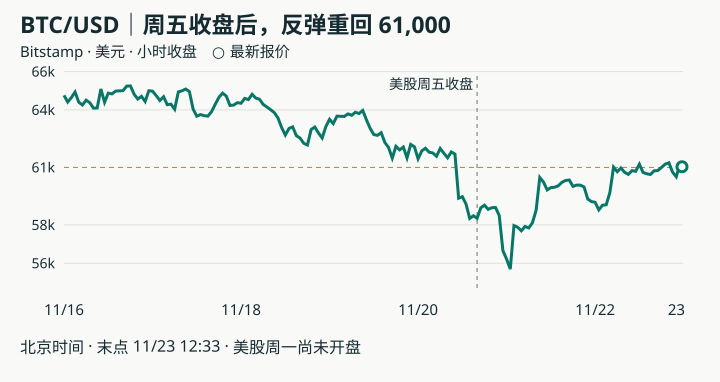

# 比特币与美股晨报｜BTC 收复 6.1 万美元，美股开盘能否保住周末反弹？

> 2026 年 11 月 23 日，北京时间约 12:35 截稿。主报价为 Bitstamp BTC/USD 现货行情时间戳 12:33:24，单位为美元。BTC 日线从北京时间 08:00（UTC 00:00）起算，23 日日线未收盘。

**截至今晚美股开盘，维持中性偏防御，置信度中等。** 昨日问的是能否站稳 60,800—61,000 美元并见到现货承接。价格条件部分兑现：周日 CoinGlass 日线收于 61,162，Bitstamp 独立收于 61,170；但周一 Bitstamp 盘中又回到 60,282，尚缺回踩期间的主动买盘证据。昨天未预设“站稳”时长，一次收盘只确认收复。今晚北京时间 23:30 看美股开盘首小时结束时 BTC 还能否守住 61,000，明早 08:00 再验日线。[昨日条件](/note?p=btc-analysis-2026-11-22) · [原口径日线](https://www.coinglass.com/currencies/BTC/historical-data/2026) · [Bitstamp 日线](https://www.bitstamp.net/api/v2/ohlc/btcusd/?step=86400&limit=9&end=1795408404)

## 周末反弹收复了多少跌幅？

| Bitstamp 现货 | 读数 |
|---|---:|
| BTC/USD 主报价 | 61,034.46 美元 |
| 滚动 24 小时 / 近 7 日 | +3.06% / 约 −6.01% |
| 23 日 UTC 开盘至报价 | −0.22% |
| 24 小时低点 / 高点 | 58,640.00 / 61,845.74 美元 |
| 24 小时成交量 | 1,646.28 BTC |

7 日以 16 日北京时间 12:33 同分钟开盘价 64,934.02 近似计算。24 小时起点为 59,222.35，今日 UTC 开盘为 61,170.53，两个涨跌幅方向相反正是起点不同所致。[交易所行情接口](https://www.bitstamp.net/api/v2/ticker/btcusd/) · [7 日基准分钟线](https://www.bitstamp.net/api/v2/ohlc/btcusd/?step=60&limit=2&end=1794803604)

图中实线为 Bitstamp 已完成小时收盘，空心点为 23 日 12:33 的盘中主报价。虚线标记周五美股收盘，周一开盘尚未进入图示时段。[小时序列](https://www.bitstamp.net/api/v2/ohlc/btcusd/?step=3600&limit=169&end=1795408404)

美东周五 09:30—16:00（北京时间 20 日 22:30 至 21 日 05:00），BTC 从开盘时段首笔 62,027.02 跌至收盘前最后半小时末价 58,342.98，**跌 5.94%**。此后至本期主报价反弹 **4.61%**，仍低于美股周五开盘时水平。因此，今晚真正值得检验的是美国交易时段能否保留这段修复。[Bitstamp 半小时线](https://www.bitstamp.net/api/v2/ohlc/btcusd/?step=1800&limit=16&end=1795208400)

| 美股指数 | 美东 11 月 20 日收盘 | 较前收 |
|---|---:|---:|
| 标普 500 | 6,910.39 | −3.7% |
| 纳斯达克综合 | 22,617.73 | −5.3% |
| 道琼斯工业平均 | 48,147.33 | −1.9% |

周五 AI 相关股票遭抛售，Anthropic 上市后的热度未能托住板块。纳指跌幅大于道指，小盘股也下跌，压力已扩散。财政部 10 年期名义收益率降至 4.92%，实际收益率为 2.77%；大华银行晨报列美元指数最近收盘 103.81，单日跌 0.08%。股、币同跌时长债走强，更符合资金寻求避险的解释。市场仍在讨论美联储加息，但现有数据不足以把周末反弹归因于政策预期转松。[美股收盘](https://apnews.com/article/wall-street-stocks-dow-nasdaq-c10b797a17c2acf37924d834efebe135) · [路透市场报道](https://www.reuters.com/business/dollar-near-19-month-peak-ai-jitters-sap-risk-appetite-2026-11-20/) · [名义](https://home.treasury.gov/resource-center/data-chart-center/interest-rates/pages/xml?data=daily_treasury_yield_curve&field_tdr_date_value_month=202611) / [实际收益率](https://home.treasury.gov/resource-center/data-chart-center/interest-rates/pages/xml?data=daily_treasury_real_yield_curve&field_tdr_date_value_month=202611) · [大华银行](https://www.uobgroup.com/assets/web-resources/research/pdf/MO_261123.pdf)

## 买方身份仍待确认

美国现货 ETF 的 20 日数据仍有分歧。Farside 暂报净流出 **1.245 亿美元**，与昨日相同，IBIT 栏仍空缺；CoinGlass 报净流出 **6.692 亿美元**。两者差约 5.447 亿美元，缺少逐基金核对，不能把差额全部列为 IBIT 补报。Farside 最近五个披露完整日（13、16—19 日）净流出 13.062 亿美元。周末没有美国基金交易日。[Farside 分项](https://farside.co.uk/bitcoin-etf-flow-all-data/) · [CoinGlass ETF](https://www.coinglass.com/currencies/BTC/etf)

CoinGlass 所覆盖市场的滚动 24 小时现货成交额为 57.2 亿美元，环比降 32.67%；同期合约清算约 1.57 亿美元，空头占 81%。清算确认反弹中有被迫买回，但现货换手收缩，仍难识别新增买盘。名义未平仓量约 392.2 亿美元，页面内涨跌方向冲突，剔除其变化率。期权提供另一条证据：北京时间 23 日 01:31，Derivasys 一周期平值隐波为 57.33%，较前一日低 1.84 个波动率点，25Δ 风险逆转仍为 −8.98 点。波动预期回落，下行保护仍较贵。同期链上已实现盈亏、交易所净流量、可比基差和主动订单流未核实；方程式新闻接口及 RSS 本次访问受限。[合约及现货快照](https://www.coinglass.com/currencies/BTC) · [期权定时快照](https://www.derivasys.com/data/btc/2026-11-22)

## 下一次验证

下表按 Bitstamp 北京时间 **23 日 22:30—23:30** 的首小时末价触发，按 **24 日 08:00** 的 UTC 日线收盘确认。60,800—61,000 沿用昨日观察带。[昨日价格结构](/note?p=btc-analysis-2026-11-22)

| 情景 | 首小时末价 | 日线确认 / 失效 | 风险含义 |
|---|---|---|---|
| 基准 | 60,800—61,000 | 留在带内；离开则失效 | 反弹方向仍待选择 |
| 偏强 | 高于 61,000 | 日收仍在其上；回落至线内或以下则失效 | 周末修复经受首轮美股交易，买盘来源仍需验证 |
| 偏弱 | 低于 60,800 | 日收仍在其下；收回该线则失效 | 防范回吐至周日低点附近时的流动性压力 |

现货持有人关注收盘能否保留修复；合约持有人重点看美股开盘跳价和保证金缓冲；链上抵押头寸应以协议预言机、清算阈值及实际退出深度衡量风险。

北京时间 **23 日 21:30** 芝加哥联储公布 10 月全国活动指数，先观察美债对增长信息的反应。**25 日 21:30** 美国公布 10 月个人收入与支出（含 PCE 物价）及三季度 GDP 第二次估计，通胀与增长组合将检验当前利率定价。**26 日 03:00** 美联储发布褐皮书；美东 26 日感恩节休市，27 日提前收盘，对应北京时间 28 日 02:00，留意假期可交易深度。[芝加哥联储](https://www.chicagofed.org/research/data/data-release-calendar) · [BEA](https://www.bea.gov/news/schedule) · [美联储](https://www.federalreserve.gov/newsevents/2026-November.htm) · [纽交所](https://www.nyse.com/trade/hours-calendars)
