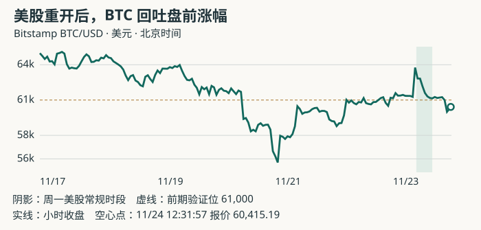

# 比特币与美股晨报｜纳指跳空反弹，BTC 守住收盘线后为何又跌回 6.1 万下方？

> 资料截止北京时间 11 月 24 日 12:33。主报价为 Bitstamp BTC/USD 现货，交易所行情时间戳 12:31:57，未提供该笔成交的独立时间。BTC 日线按 UTC 划分，北京时间 08:00 换日，24 日尚未收盘。

**昨日偏强价格情景已兑现，今日至美股收盘转为中性偏弱，置信度中等。** Bitstamp 在昨晚 23:30 首小时结束时报 63,329.73 美元，今早 08:00 日线收于 61,209.32，两次均高于预设的 61,000。此后回落至 **60,415.19 美元**。改判依据是美股交易时段 BTC 跑输纳指、收盘后跌势延续。主动买卖数据尚不足以识别卖方。今晚 23:30 再看 BTC 能否收复 61,000，明早 05:00 按美股收盘验证。[昨日条件](/note?p=btc-analysis-2026-11-23) · [首小时](https://www.bitstamp.net/api/v2/ohlc/btcusd/?step=1800&limit=15&end=1795467600) · [日线](https://www.bitstamp.net/api/v2/ohlc/btcusd/?step=86400&limit=9&end=1795494713)

## 纳指涨了 6.51%，为什么 BTC 的表现仍显弱？

| 美股指数 | 美东 11 月 23 日收盘 | 较周五收盘 |
|---|---:|---:|
| 标普 500 | 7,237.17 | +4.73% |
| 纳斯达克综合 | 24,089.56 | +6.51% |
| 道琼斯工业平均 | 49,595.31 | +3.01% |

周一纳指以 24,269.75 点跳空高开，常规交易时段实际**回落 0.74%**。同一窗口（美东 09:30—16:00，北京时间 23 日 22:30 至 24 日 05:00），Bitstamp 从 64,185.22 跌至 61,143.18 美元，**跌 4.74%**；美股收盘后至主报价再跌 **1.19%**。两者开盘后均回落，BTC 多跌约 4 个百分点。周五美股收盘时 BTC 为 58,342.98 美元，周末以来的修复仍保留一部分。[美股收盘](https://apnews.com/article/wall-street-stocks-dow-nasdaq-fcdf1bad36b4f81c90cbb0f33a2c5704) · [纳指开盘与收盘](https://www.investing.com/indices/nasdaq-composite-historical-data) · [BTC 半小时线](https://www.bitstamp.net/api/v2/ohlc/btcusd/?step=1800&limit=15&end=1795467600) · [周五锚点](/note?p=btc-analysis-2026-11-23)

英伟达董事会恢复黄仁勋的 CEO 职务，为科技股提供了具体催化剂；公告前股指期货已指向反弹，单一公司事件只能解释部分涨幅。同期美国综合 PMI 初值从 55.9 降至 54.6，企业活动仍在扩张。美元指数从周五 103.81 升至周一 104.32；美国 10 年期名义收益率持平于 4.92%，实际收益率从 2.77% 升至 2.79%。这些价格削弱了“宽松预期推动所有风险资产上涨”的解释。12 月利率预期缺少同一时点的期货快照。[英伟达公告](https://nvidianews.nvidia.com/news/nvidia-board-reinstates-jensen-huang-as-president-ceo-and-board-director) · [PMI](https://www.reuters.com/world/us/us-business-activity-growth-eases-further-november-survey-shows-2026-11-23/) · [美元](https://www.investing.com/indices/usdollar-historical-data) · [名义](https://home.treasury.gov/resource-center/data-chart-center/interest-rates/pages/xml?data=daily_treasury_yield_curve&field_tdr_date_value_month=202611) / [实际收益率](https://home.treasury.gov/resource-center/data-chart-center/interest-rates/pages/xml?data=daily_treasury_real_yield_curve&field_tdr_date_value_month=202611)

## BTC 快照与资金分歧

| Bitstamp 现货 | 读数 |
|---|---:|
| 主报价 | 60,415.19 美元 |
| 滚动 24 小时 / 近 7 日 | −1.00% / 约 −6.93% |
| 当前 UTC 日内 | −1.24% |
| 滚动 24 小时低—高 | 59,380.00—64,504.62 美元 |
| 滚动 24 小时成交量 | 1,679.14 BTC |

7 日采用上周同分钟开盘价 64,912.62 近似计算；今日 UTC 开盘为 61,173.03。[交易所行情](https://www.bitstamp.net/api/v2/ticker/btcusd/) · [7 日基准](https://www.bitstamp.net/api/v2/ohlc/btcusd/?step=60&limit=2&end=1794889913) · [日线](https://www.bitstamp.net/api/v2/ohlc/btcusd/?step=86400&limit=9&end=1795494713)

实线为已完成小时收盘，阴影标出周一美股常规交易时段。空心点为本期盘中报价。[Bitstamp 小时线](https://www.bitstamp.net/api/v2/ohlc/btcusd/?step=3600&limit=169&end=1795494713)

**ETF 修订（美东 20 日）**：Farside 原暂报 −1.245 亿美元，补齐 IBIT 的 −5.447 亿后为 **−6.692 亿美元**，与昨日另一个来源的读数一致。23 日暂报 −0.604 亿，IBIT 仍空缺。17、18、19、20、23 日五个交易日暂计 −18.583 亿；最近五个分项齐备日（16—20 日）合计 −17.900 亿。赎回构成反弹之前的压力，但周一数据尚不能证明压力已显著减轻。[Farside 逐基金表](https://farside.co.uk/btc/)

CoinGlass 跨交易所页面快照显示，滚动 24 小时现货成交 82 亿美元，合约清算 3.47 亿美元，空头约占 58%；价格走低时两侧均有强平。美元名义未平仓量 392.7 亿，持仓加权资金费率 0.0007%。缺少可比币本位持仓与基差，难以区分新增空头和多头撤退。北京时间 24 日 01:31，一周期平值隐波为 50.08%，日降 7.25 个波动率点，25Δ 看涨减看跌隐波仍为 −7.98 点。保险价格回落，看跌保护依然较贵。[合约快照](https://www.coinglass.com/currencies/BTC) · [Derivasys 期权快照](https://www.derivasys.com/data/btc/2026-11-23)

截至 22 日的 Glassnode 周报显示，所覆盖现货市场主动买卖成交差额由 −1.708 亿收窄至 −1.209 亿美元，链上处于浮盈的供应占比则从 54.2% 降至 47.3%。此前抛压有所缓解，持币者的利润缓冲却在变薄。周一时段缺少同步订单流及交易所净流量，无法把上述周度变化直接归因于当天交易。方程式新闻 REST 与中文 RSS 本次未能访问。[Glassnode 周报](https://research.glassnode.com/btc-market-pulse-week-48-2026/)

## 未来一个交易日如何验证

使用 Bitstamp 北京时间 **24 日 23:30** 美股首小时末价触发，**25 日 05:00** 美股收盘时复核。61,000 沿用昨日验证位，59,380 取自本期已出现的低点。[价格来源](https://www.bitstamp.net/api/v2/ohlc/btcusd/?step=86400&limit=9&end=1795494713)

| 情景 | 首小时末价 | 收盘确认 / 失效 | 风险含义 |
|---|---|---|---|
| 基准 | 59,380—61,000 | 仍在区间内确认，越界失效 | 美股反弹向 BTC 的传导仍弱 |
| 偏强 | 高于 61,000 | 收盘仍高于该线确认，跌回失效 | 下调回吐风险，买方身份仍待核实 |
| 偏弱 | 低于 59,380 | 收盘仍低于该线确认，收回失效 | 周末修复面临进一步回吐 |

现货关注美股收盘时 BTC 能否保留涨幅；合约关注昨日大幅高开低走环境下的双向清算；链上抵押关注预言机价格触及清算线时的退出深度。

**北京时间**：今晚 21:00 百思买财报电话会，可观察电子消费需求能否印证科技股反弹。25 日 21:30，美国发布 10 月个人收入与支出（含 PCE 物价）及三季度 GDP 第二次估计，关注实际利率如何反应。26 日 03:00 美联储发布褐皮书；美东 26 日感恩节休市，27 日提前收盘（北京时间 28 日 02:00），跨市场验证窗口相应缩短。[百思买](https://www.investors.bestbuy.com/News--Events/events-and-presentations/events/event-details/2026/Q3-FY27-Best-Buy-Co-Inc-Earnings-Call/default.aspx) · [BEA](https://www.bea.gov/news/schedule) · [美联储](https://www.federalreserve.gov/newsevents/2026-November.htm) · [纽交所](https://www.nyse.com/trade/hours-calendars)
