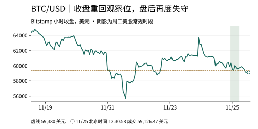

# 比特币与美股午报｜纳指收在开盘附近，比特币同期跌约 1%

周二美股开盘到收盘，纳指几乎持平，比特币跌约 1%，收盘后再跌近 1%。昨天约好的两个时点，币价都在区间内，盘中和盘后却都跌破过 59,380 美元。[昨日条件](/note?p=btc-analysis-2026-11-24) · [分时](https://www.bitstamp.net/api/v2/ohlc/btcusd/?step=1800&limit=15&end=1795554000)

**今晚看 59,710 美元。** 比特币连续两天弱于同期纳指，谁在卖仍不清楚。北京时间 21:30 公布美国物价数据，首小时略看弱，把握中等。若 22:30、23:30 都高于该价，就上调判断。[日程](https://www.bea.gov/news/schedule)

## 美股和比特币，分别在哪段时间下跌？

| 美东 11 月 24 日 | 收盘点位 | 较周一收盘 |
|---|---:|---:|
| 标普 500 | 7,201.09 | −0.50% |
| 纳斯达克综合指数 | 23,733.54 | −1.48% |
| 道琼斯工业平均指数 | 50,018.70 | +0.85% |

纳指当天开在 23,745.86 点。表里的 **−1.48%** 大多发生在周一收盘到周二开盘之间。从周二开盘算起，纳指只跌 **0.05%**。同期比特币从 60,347.92 跌至 59,710.01 美元，跌 **1.06%**。美股收盘后至本期报价，比特币再跌 **0.98%**。周二常规交易为美东 09:30 至 16:00，即北京时间 24 日 22:30 至 25 日 05:00。[三大指数](https://apnews.com/article/wall-street-stocks-dow-nasdaq-6cc4e580290aadf304ee316d6d46dd81) · [纳指开收盘](https://www.investing.com/indices/nasdaq-composite-historical-data) · [比特币分时](https://www.bitstamp.net/api/v2/ohlc/btcusd/?step=1800&limit=15&end=1795554000)

英伟达周一大涨后回落 5.9%，标普 500 多数成分股却上涨。百思买同店销售增长 6.1%，并上调全年预期。跌势集中在科技权重股。美元指数从 104.32 降至 103.81，美国十年期国债收益率从 4.92% 微降至 4.91%，扣除通胀影响后的实际收益率维持 2.79%。比特币走弱时，美元和长期利率都没有上行。[美股综述](https://apnews.com/article/stock-markets-ai-earnings-oil-feec0e25b9994b1c86b16329cf770192) · [百思买财报](https://www.sec.gov/Archives/edgar/data/764478/000076447826000045/bby-fy27q3xexx99.htm) · [美元指数](https://www.investing.com/indices/usdollar-historical-data) · [美债收益率](https://home.treasury.gov/resource-center/data-chart-center/interest-rates/pages/xml?data=daily_treasury_yield_curve&field_tdr_date_value_month=202611) · [实际收益率](https://home.treasury.gov/resource-center/data-chart-center/interest-rates/pages/xml?data=daily_treasury_real_yield_curve&field_tdr_date_value_month=202611)

## 比特币报多少？昨天的判断兑现了吗？

| Bitstamp 比特币美元现货 | 本期读数 |
|---|---:|
| 最近成交 | 59,126.47 美元 |
| 过去 24 小时 | −2.17% |
| 过去 7 日 | 约 −8.32% |
| 北京时间今天 08:00 以来 | −1.03% |
| 24 小时最低至最高 | 58,860.00 至 60,688.09 美元 |
| 24 小时成交量 | 1,308.84 枚比特币 |

北京时间 11 月 25 日 **12:32 截稿**。末笔成交时间 12:30:58，编号 681503268，行情快照取于 12:31:05。交易所按 UTC 换日，北京时间 08:00 开始的日线尚未收盘。24 小时和当日涨跌分别以 60,436.96 和 59,743.49 美元为起点。7 日表现以 18 日同一分钟开盘的 64,493.15 美元近似计算。[该分钟历史收盘](https://www.bitstamp.net/api/v2/ohlc/btcusd/?step=60&limit=1&end=1795581059) · [实时成交接口](https://www.bitstamp.net/api/v2/transactions/btcusd/?time=minute) · [行情接口](https://www.bitstamp.net/api/v2/ticker/btcusd/) · [7 日基准](https://www.bitstamp.net/api/v2/ohlc/btcusd/?step=60&limit=2&end=1794976261) · [日线](https://www.bitstamp.net/api/v2/ohlc/btcusd/?step=86400&limit=9&end=1795581061)

图中阴影结束时，比特币回到虚线之上，右侧的空心点却又落到线下。昨天约定的区间是 59,380 至 61,000 美元。昨晚 23:30 报 59,819.44，今早 05:00 报 59,710.01，均在区间内。两次之间一度跌至 59,196.83。图线取每小时收盘价，盘中低点另查半小时线。[昨日条件](/note?p=btc-analysis-2026-11-24) · [小时走势](https://www.bitstamp.net/api/v2/ohlc/btcusd/?step=3600&limit=169&end=1795581061) · [盘中低点](https://www.bitstamp.net/api/v2/ohlc/btcusd/?step=1800&limit=15&end=1795554000)

## 卖压从哪里来？

美国现货比特币 ETF 是可以像股票一样买卖、跟踪比特币现货价格的基金。**周一从这批基金净流出的资金，补报后由约 6,000 万美元扩大到约 5.7 亿美元。** 差额来自后来补上的贝莱德旗下 IBIT 周一数据。周二暂报净流出 5,610 万美元，仍缺这只基金。周二的卖压是否减轻，要等数据补齐。基金日度总额也无法指认盘中卖家。[各基金逐日明细](https://farside.co.uk/btc/)

展开核对基金补报和最近五个交易日

美东 11 月 23 日的净流量从 −0.604 亿美元修订为 −5.697 亿美元，差额 −5.093 亿美元。11 月 18、19、20、23、24 日合计暂为 −21.838 亿美元，其中 24 日仍缺 IBIT。最近五个分项齐全的交易日（17 至 23 日）合计 −23.676 亿美元。[Farside 逐基金表](https://farside.co.uk/btc/)

看涨合约也可能因保证金不足被迫平仓。CoinGlass 覆盖的交易所过去 24 小时共有 8,744 万美元合约被强制平仓，其中看涨一方占 6,229 万美元。总额低于上期快照的 3.47 亿美元，价格却继续下跌。强平可能放大了跌幅，现有证据还不足以把它列为主因。[跨交易所快照](https://www.coinglass.com/currencies/BTC)

展开查看合约、期权和链上数据

同一快照中，现货成交 59.2 亿美元。每笔成交都有买卖双方，这个总额无法说明谁在主动卖出。未平仓合约价值 389.2 亿美元，按持仓加权的资金费率（多空双方定期支付的费用）为 0.0044%。当日的主动买卖差额、交易所净流量及按币数计算的持仓变化缺少可靠读数。Glassnode 截至 22 日的样本中，主动卖出占优，按上次链上移动价格估算，47.3% 的比特币处于盈利状态。这份周报只能作为前期背景。[合约数据](https://www.coinglass.com/currencies/BTC) · [链上周报](https://research.glassnode.com/btc-market-pulse-week-48-2026/)

北京时间 12:31，Deribit 的 12 月 25 日期货比当时的指数贵约 0.34%。从期权价格可反推市场预期的波动幅度。12 月 4 日到期的合约按年率计算，59,000 美元行权价这一档为 52.39%，56,000 美元看跌为 58.27%，62,000 美元看涨为 48.89%。这两档里，下跌保护较贵。两档对现货价格的敏感度（Delta 绝对值）分别约为 0.26、0.29，并非严格对称。[期货](https://www.deribit.com/api/v2/public/ticker?instrument_name=BTC-25DEC26) · [59,000 看涨](https://www.deribit.com/api/v2/public/ticker?instrument_name=BTC-4DEC26-59000-C) · [56,000 看跌](https://www.deribit.com/api/v2/public/ticker?instrument_name=BTC-4DEC26-56000-P) · [62,000 看涨](https://www.deribit.com/api/v2/public/ticker?instrument_name=BTC-4DEC26-62000-C)

## 今晚几点看，怎样才算判断变了？

北京时间 **25 日 21:30**，美国同时公布 10 月个人收入与支出及第三季度经济增速的第二次估计。前者包含 PCE 物价指数，衡量居民购买的商品和服务价格涨了多少。市场此前仍在权衡美联储 12 月加息的可能，两份数据都可能改变利率预期。公布后可以一起看美元、美债和比特币如何反应，同时公布也让单项数据的影响难以拆分。[美国经济分析局](https://www.bea.gov/news/schedule) · [利率预期](https://www.reuters.com/business/dollar-climbs-renewed-ai-euphoria-fuels-fed-hike-bets-2026-11-24/)

以 Bitstamp 在 **22:30 前的最后一笔成交**初判，**23:30 前的最后一笔**确认。59,710 美元取周二美股收盘时的比特币价格，58,860 美元是本期 24 小时低点。[收盘依据](https://www.bitstamp.net/api/v2/ohlc/btcusd/?step=1800&limit=15&end=1795554000) · [区间低点](https://www.bitstamp.net/api/v2/ohlc/btcusd/?step=86400&limit=9&end=1795581061)

| 22:30 的价格（美元） | 23:30 怎样算确认 | 对判断的影响 |
|---|---|---|
| 58,860 至 59,710（含两端） | 仍在区间内，越界即失效 | 维持略偏弱，方向仍未明确 |
| 高于 59,710 | 仍高于该价，回到该价或以下即失效 | 收复盘后跌幅，上调短线判断 |
| 低于 58,860 | 仍低于该价，回到该价或以上即失效 | 跌势延续，假期成交清淡可能放大波动 |

持有现货的人，可用两次报价分辨反弹能否维持。合约要防数据公布后价格来回急跳，迅速耗尽保证金。用比特币作链上抵押的人，还需看协议什么时候更新抵押品价格，以及市场波动时能否及时退出。

**接下来一周先看假期。** 北京时间 26 日 03:00，美联储发布汇总各地区经济情况的褐皮书。美东 26 日感恩节美股休市，27 日提前收盘，对应北京时间 28 日 02:00，比特币在此期间照常交易。本期方程式新闻接口及备用订阅均未能访问，行业快讯覆盖有限。[美联储日程](https://www.federalreserve.gov/newsevents/2026-November.htm) · [纽交所日历](https://www.nyse.com/trade/hours-calendars)

> **11 月 25 日北京时间 18:48 更正**　原文称“跌破发生在验证窗口结束后”。Bitstamp 半小时线显示，00:30—01:00 已跌至 59,260.01 美元，下一时段最低 59,196.83 美元，05:00 收于 59,710.01 美元。盘中跌破、收盘收复、盘后再度失守，分别发生在三个时段。本次更正依据为原截稿时已产生的数据。[Bitstamp 半小时线](https://www.bitstamp.net/api/v2/ohlc/btcusd/?step=1800&limit=15&end=1795554000)
