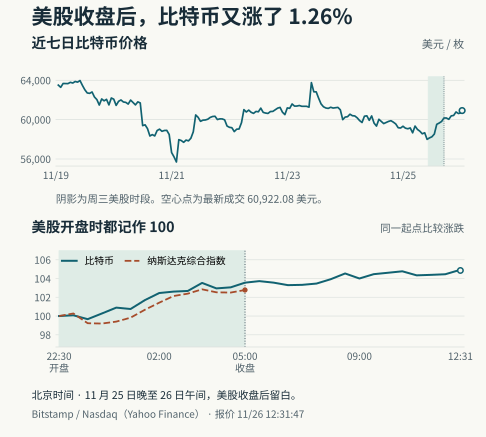

# 比特币与美股午报｜币价反弹，基金买盘跟上了吗？

周三美股交易时段，比特币涨得比纳指多，收盘后又涨 **1.26%**。昨晚两次检查都低于 58,860 美元，偏弱判断兑现。随后币价重回 6 万美元上方。[昨日判断](/note?p=btc-analysis-2026-11-25) · [分时走势](https://www.bitstamp.net/api/v2/ohlc/btcusd/?step=1800&limit=33&end=1795667512)

**短线从略偏弱上调至中性，把握中等。** 反弹延续到了美股收盘后，但美国比特币基金仍报净流出。北京时间今晚 22:30 和明早 08:00，若两次都低于 **60,166 美元**，就下调判断。[收盘依据](https://www.bitstamp.net/api/v2/ohlc/btcusd/?step=60&limit=4&end=1795640400) · [基金流量](https://farside.co.uk/btc/)

## 纳指全天收跌，为什么开盘后反而与比特币同涨？

美东 11 月 25 日是感恩节前最后一个完整交易日。下表涨跌均与周二收盘比较。[三大指数收盘](https://apnews.com/article/wall-street-stocks-dow-nasdaq-94fdb0ecb060ec65c0b02879ce0d2d09) · [市场综述](https://www.reuters.com/business/nasdaq-futures-slide-over-2-fresh-us-tariff-concerns-inflation-data-focus-2026-11-25/)

| 指数 | 周三收盘（点） | 较周二 |
|---|---:|---:|
| 标普 500 | 7,182.78 | −0.25% |
| 纳斯达克综合指数 | 23,585.80 | −0.62% |
| 道琼斯工业平均指数 | 50,182.95 | +0.33% |

纳指大幅低开在 22,948.48 点，到收盘反而涨了 **2.78%**。在同一时段（美东 09:30 至 16:00，北京时间 25 日 22:30 至 26 日 05:00），Bitstamp 比特币从 58,098.44 涨到 60,166.43 美元，涨 **3.56%**。连续两个交易时段落后纳指后，这次领先约 0.78 个百分点。美股收盘后，比特币又涨到 60,922.08 美元。[纳指开收盘](https://www.investing.com/indices/nasdaq-composite-historical-data) · [比特币半小时线](https://www.bitstamp.net/api/v2/ohlc/btcusd/?step=1800&limit=33&end=1795667512) · [成交接口](https://www.bitstamp.net/api/v2/transactions/btcusd/?time=minute)

昨天的检查取整点**前**最后一笔。22:30 前报 58,102.03，23:30 前报 57,904.45，两次都低于原定下限，也未达到上调判断所需的 59,710 美元。上段计算美股时段收益，则从 22:30 开盘**后**第一笔算起。昨晚两次的结果和今早的反弹可以分别验证。[22:30 前后](https://www.bitstamp.net/api/v2/ohlc/btcusd/?step=60&limit=4&end=1795617000) · [23:30 前后](https://www.bitstamp.net/api/v2/ohlc/btcusd/?step=60&limit=4&end=1795620600)

## 比特币快照

| Bitstamp 美元现货 | 本期读数 |
|---|---:|
| 最近成交 | 60,922.08 美元 |
| 滚动 24 小时 / 近 7 日 | +3.07% / 约 −3.78% |
| 北京时间今天 08:00 起 | +0.89%（未收盘） |
| 24 小时最低至最高 | 57,209.34 至 61,509.00 美元 |
| 24 小时成交量 | 1,994.97 枚比特币 |

北京时间 **11 月 26 日 12:36 截稿**。主报价成交于 12:31:47，编号 682385845。交易所快照时间 12:31:52，抓取于 12:31:54。24 小时起点为 59,107.55 美元。日线按 UTC 零时换日，对应北京时间 08:00，开盘 60,381.88 美元。7 日对比采用 19 日同一分钟开盘 63,316.02 美元。[行情口径](https://www.bitstamp.net/api/v2/ticker/btcusd/) · [成交所在分钟](https://www.bitstamp.net/api/v2/ohlc/btcusd/?step=60&limit=2&end=1795667507) · [7 日基准](https://www.bitstamp.net/api/v2/ohlc/btcusd/?step=60&limit=2&end=1795062707) · [日线](https://www.bitstamp.net/api/v2/ohlc/btcusd/?step=86400&limit=10&end=1795651200)

看下图虚线的终点。美股收盘时，两边都已反弹，只有比特币还能继续交易。上图取整点已收小时线，空心点单列本期成交。下图按北京时间每半小时对齐，以各自开盘为 100，纳指末点用正式收盘。[七日小时线](https://www.bitstamp.net/api/v2/ohlc/btcusd/?step=3600&limit=169&end=1795667533) · [比特币分时](https://www.bitstamp.net/api/v2/ohlc/btcusd/?step=1800&limit=33&end=1795667512) · [纳指分时](https://query1.finance.yahoo.com/v8/finance/chart/%5EIXIC?period1=1795617000&period2=1795640400&interval=30m&includePrePost=false) · [正式收盘](https://www.investing.com/indices/nasdaq-composite-historical-data)

## 价格回来了，哪些资金没有跟上？

美国现货比特币 ETF 是跟踪币价的上市基金。周二净流出从约 **5,600 万**扩大到约 **2.31 亿美元**，因为贝莱德旗下 IBIT 补报了周二的数据。周三已披露部分又流出 **1.233 亿美元**，仍缺 IBIT。周四美股休市，周四币价变化要与这些较早的赎回分开看。[逐基金原表](https://farside.co.uk/btc/) · [休市日历](https://www.nyse.com/trade/hours-calendars)

| 美东交易日 | 上次净额 → 最新净额（万美元） | 差额及影响 |
|---|---:|---|
| 11 月 24 日 | −5,610 → −23,140 | IBIT 补报 −17,530，先前低估赎回规模 |

19、20、23、24、25 日五个交易日暂计净流出 **21.759 亿美元**，含周三缺项。最近五个分项齐全的交易日（18 至 24 日）合计净流出 **23.591 亿美元**。[历史分项](https://farside.co.uk/bitcoin-etf-flow-all-data/)

另看币安以稳定币 USDT 计价的比特币现货。周三美股常规时段，买方主动接受卖家报价的交易占成交额 49.0%，周二同期为 52.7%。即使币价反弹，这一家交易所主动卖出的金额仍略大。Coin Metrics 标记的交易所地址，25 日 UTC 全天初报净转入 2,340 枚比特币，24 日净转出 33 枚。币转入后也可能调拨或留存。当天链上已实现盈亏的金额仍缺可靠读数。[币安周三](https://data-api.binance.vision/api/v3/klines?symbol=BTCUSDT&interval=30m&startTime=1795617000000&endTime=1795640399999&limit=13) · [周二](https://data-api.binance.vision/api/v3/klines?symbol=BTCUSDT&interval=30m&startTime=1795530600000&endTime=1795553999999&limit=13) · [链上数据](https://community-api.coinmetrics.io/v4/timeseries/asset-metrics?assets=btc&metrics=FlowInExNtv,FlowOutExNtv,CapMVRVCur&frequency=1d&start_time=2026-11-23&end_time=2026-11-25) · [地址口径](https://docs.coinmetrics.io/network-data/network-data-overview/exchange/net-flows)

展开看合约和期权怎样给这轮反弹定价

CoinGlass 覆盖的交易所北京时间 12:31 快照显示，过去 24 小时现货成交约 76.17 亿美元，未平仓合约名义价值约 403.80 亿美元，较 24 小时前增 3.72%。币价上涨也会抬高美元持仓额，币数变化尚未核实。被迫平仓的合约从上期的 0.87 亿增至 2.64 亿美元，其中看跌一方 1.43 亿。多空两边都承受损失，难以认定反弹由空头回补主导。[跨交易所快照](https://www.coinglass.com/currencies/BTC)

12:31，Deribit 比特币永续合约的 8 小时资金费率为 +0.0127%（多头付费），12 月 25 日期货比现货指数贵 0.38%，略高于上期的 0.34%。12:33，同为 12 月 4 日到期，58,000 看跌与 64,000 看涨期权的隐含年化波动率为 54.12% 和 47.88%，对币价的敏感度绝对值分别约 0.25 和 0.26。两档相距现价接近，下跌保护仍较贵，这 6.24 个百分点是两张合约的差值。[永续](https://www.deribit.com/api/v2/public/ticker?instrument_name=BTC-PERPETUAL) · [到期期货](https://www.deribit.com/api/v2/public/ticker?instrument_name=BTC-25DEC26) · [看跌](https://www.deribit.com/api/v2/public/ticker?instrument_name=BTC-4DEC26-58000-P) · [看涨](https://www.deribit.com/api/v2/public/ticker?instrument_name=BTC-4DEC26-64000-C)

## 休市期间，怎样的价格会改变判断？

周三美国公布，10 月个人消费支出价格指数（PCE）同比涨 **3.8%**，剔除食品和能源后涨 **3.3%**。第三季度实际经济增速从初估 3.4% 上修至 4.3%（按年率）。市场仍在权衡 12 月加息，美国同时提议对 14 个经济体的部分商品加征关税。当天美元指数从 103.81 降至 103.67，十年期美债名义和实际收益率均降 6 个基点，分别收于 4.85% 和 2.73%。利率回落有利于风险资产收复跌幅，而多项消息同时出现，无法把反弹单归给通胀数据。[物价](https://www.bea.gov/news/2026/personal-income-and-outlays-october-2026) · [经济增速](https://www.bea.gov/news/2026/gdp-second-estimate-and-corporate-profits-3rd-quarter-2026) · [关税提案](https://www.ustr.gov/about/policy-offices/press-office/press-releases/2026/november/ustr-makes-determinations-and-proposes-actions-14-section-301-investigations-relating-structural) · [快讯线索](https://eqn.news/tradfi/17396) · [利率预期](https://www.reuters.com/business/nasdaq-futures-slide-over-2-fresh-us-tariff-concerns-inflation-data-focus-2026-11-25/) · [美元](https://www.investing.com/indices/usdollar-historical-data) · [名义利率](https://home.treasury.gov/resource-center/data-chart-center/interest-rates/pages/xml?data=daily_treasury_yield_curve&field_tdr_date_value_month=202611) · [实际利率](https://home.treasury.gov/resource-center/data-chart-center/interest-rates/pages/xml?data=daily_treasury_real_yield_curve&field_tdr_date_value_month=202611)

用 Bitstamp 在 **26 日 22:30 前**最后一笔初判，**27 日 08:00 前**最后一笔确认。区间下沿 60,166 美元取周三美股收盘时的币价，上沿 61,509 美元取本期 24 小时高点。[收盘依据](https://www.bitstamp.net/api/v2/ohlc/btcusd/?step=60&limit=4&end=1795640400) · [近 24 小时分时](https://www.bitstamp.net/api/v2/ohlc/btcusd/?step=900&limit=96&end=1795667512)

| 今晚 22:30（美元） | 明早 08:00 确认条件 | 对判断的影响 |
|---|---|---|
| 60,166 至 61,509，含两端 | 仍在区间内，越界即失效 | 维持中性，守住美股收盘附近，未突破前高 |
| 高于 61,509 | 仍高于高点，回到该价或以下即失效 | 偏强，突破经受住假期交易 |
| 低于 60,166 | 仍低于该线，回到该价或以上即失效 | 偏弱，盘后涨幅已回吐 |

现货持有人要防休市时的短暂突破。合约双向跳价会消耗保证金，链上抵押还要看协议更新价格的时点和实际可成交的深度。周五 **27 日 21:30** 美国公布 10 月商品贸易与库存初值，可能改变增长预期。美股 **22:30** 重开、**28 日 02:00** 提前收盘，再核对假期涨幅能否延续。下周 **12 月 1 日 23:00**，美国制造业调查与职位空缺同时发布，可再检验利率和风险资产的反应。以上均为北京时间。[统计局日程](https://www.census.gov/econ/indicators/release_schedule.html) · [纽交所](https://www.nyse.com/trade/hours-calendars) · [制造业调查](https://www.ismworld.org/supply-management-news-and-reports/reports/rob-report-calendar) · [职位空缺](https://www.bls.gov/schedule/2026/12_sched_list.htm)
