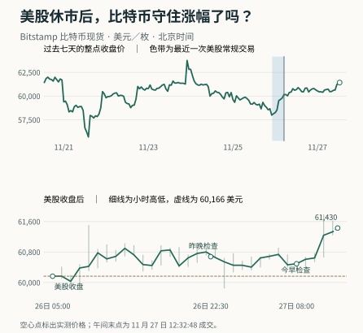

# 比特币与美股午报｜美股休市，比特币守住了多少涨幅？

美股休市后，比特币一度跌破 6 万美元，到今天午间已比周三美股收盘时高出约 1,260 美元。昨天约好看的两笔价格，昨晚是 60,678.59 美元，今早是 60,492.37 美元，都在原定的 60,166 至 61,509 美元之间。价格守住区间的判断兑现，基金买盘回暖仍待验证。[昨日原文](/note?p=btc-analysis-2026-11-26) · [昨晚 22:30 前](https://www.bitstamp.net/api/v2/ohlc/btcusd/?step=60&limit=4&end=1795703400) · [今早 08:00 前](https://www.bitstamp.net/api/v2/ohlc/btcusd/?step=60&limit=4&end=1795737600)

**到今晚美股这半个交易日结束，维持中性，把握中等。** 币价经受住了假期波动，但节前基金撤走的钱比昨天知道的多了约 3.3 亿美元。北京时间今晚 23:30 和明天 02:00，若两次都高于 61,789 美元，上调为偏强；若都低于 60,166 美元，下调为偏弱。[基金补报](https://farside.co.uk/btc/) · [价格依据](https://www.bitstamp.net/api/v2/ohlc/btcusd/?step=3600&limit=170&end=1795753969)

## 从跌破 6 万到上涨 2.10%，休市期间发生了什么？

| Bitstamp 比特币美元现货 | 截至本期 |
|---|---:|
| 最近成交 | 61,430.29 美元 |
| 滚动 24 小时 / 近 7 日 | +0.81% / 约 −0.08% |
| 今日 UTC 开盘以来 | +1.58%，日线未收盘 |
| 滚动 24 小时最低 / 最高 | 59,844.30 / 61,789.29 美元 |
| 滚动 24 小时成交量 | 772.91 枚 BTC |

北京时间 **11 月 27 日 12:35 资料截止**。主报价成交于 12:32:48，编号 683069137；交易所于 12:32:55 更新快照，12:32:56 抓取。24 小时起点 60,933.99 美元；日线从北京时间 08:00 的 60,477.13 美元起算。7 日以 20 日同一分钟开盘价 61,480.01 美元近似比较。Coinbase 在 12:32:54 成交于 61,411.37 美元，仅作交叉核对。[Bitstamp 行情](https://www.bitstamp.net/api/v2/ticker/btcusd/) · [成交所在分钟](https://www.bitstamp.net/api/v2/ohlc/btcusd/?step=60&limit=3&end=1795753975) · [7 日基准](https://www.bitstamp.net/api/v2/ohlc/btcusd/?step=60&limit=3&end=1795149175) · [Coinbase](https://api.exchange.coinbase.com/products/BTC-USD/ticker)

看下图的细线。昨晚 23:00 至零时，币价最低跌到周三美股收盘参照线下方，但该小时收盘已回到线上。今早 10:00 至 11:00 又摸到 61,789.29 美元，午间没有留在高点。上图为等间隔小时收盘价，空心末点单列今天的成交；休市期间只有比特币交易。[七日原始小时线](https://www.bitstamp.net/api/v2/ohlc/btcusd/?step=3600&limit=170&end=1795753969)

## 股票没开市，哪些信号还能用？

美东 11 月 26 日感恩节休市，下表为 **25 日周三** 的完整收盘，涨跌相对周二收盘。[三指数收盘](https://apnews.com/article/94fdb0ecb060ec65c0b02879ce0d2d09) · [交易日历](https://www.nyse.com/trade/hours-calendars)

| 指数 | 收盘点位 | 较前收盘 |
|---|---:|---:|
| 标普 500 | 7,182.78 | −0.25% |
| 纳斯达克综合指数 | 23,585.80 | −0.62% |
| 道琼斯工业平均指数 | 50,182.95 | +0.33% |

若只比较周三美东 09:30 至 16:00（北京时间 25 日 22:30 至 26 日 05:00），纳指从低开位置涨 **2.78%**，同期比特币从 58,098.44 涨至 60,166.43 美元，涨 **3.56%**。美股收盘后至本期成交，比特币再涨 **2.10%**。假期这段没有同期纳指回报可比。[纳指分日开收盘](https://query1.finance.yahoo.com/v8/finance/chart/%5EIXIC?interval=1d&range=5d) · [BTC 开盘](https://www.bitstamp.net/api/v2/ohlc/btcusd/?step=60&limit=4&end=1795617000) · [BTC 收盘](https://www.bitstamp.net/api/v2/ohlc/btcusd/?step=60&limit=4&end=1795640400)

周三公布的美国 10 月消费支出价格同比涨 3.8%，剔除食品和能源后涨 3.3%。同日十年期美债名义和实际收益率各降 0.06 个百分点至 4.85% 和 2.73%，与科技股低开后的修复方向一致。周四没有新的官方收益率；周五 12:22 美元指数报 103.727，略高于周三收盘的 103.67。仅凭这点变化，很难把币价走强归因于美元走弱或美联储降息预期。同期利率期货隐含概率未核实。[美国经济分析局](https://www.bea.gov/news/2026/personal-income-and-outlays-october-2026) · [名义收益率](https://home.treasury.gov/resource-center/data-chart-center/interest-rates/pages/xml?data=daily_treasury_yield_curve&field_tdr_date_value_month=202611) · [实际收益率](https://home.treasury.gov/resource-center/data-chart-center/interest-rates/pages/xml?data=daily_treasury_real_yield_curve&field_tdr_date_value_month=202611) · [美元指数](https://query1.finance.yahoo.com/v8/finance/chart/DX-Y.NYB?interval=1d&range=5d)

假期还有一条科技股消息。《金融时报》报道，英伟达要求合作伙伴暂停向四个东南亚国家交付含其芯片的服务器，暂停多久仍不清楚。消息出在周三收盘之后；今晚可观察科技股重开如何定价，对比特币的直接影响尚无证据。[原始报道](https://www.ft.com/content/7838a715-07d4-4605-aa60-21f5af2b2370) · [方程式快讯](https://eqn.news/tradfi/17499)

## 币价回升，基金的钱回来了吗？

美国现货比特币 ETF 是可在股票市场交易的比特币基金。贝莱德 IBIT 补报后，**周三净流出从约 1.23 亿扩大至 4.53 亿美元**。11 月 19、20、23、24、25 日五个交易日合计净流出 **25.056 亿美元**，逐基金分项已齐。假期币价反弹发生在这些赎回之后；周四休市，没有当日申赎数据。[逐基金原表](https://farside.co.uk/btc/) · [完整历史](https://farside.co.uk/bitcoin-etf-flow-all-data/)

| 修订所属美东交易日 | 原值 → 最新值（百万美元） | 差额与原因 |
|---|---:|---|
| 11 月 25 日 | −123.3 → −453.0 | −329.7，全部来自 IBIT 补报 |

现货有一点好转。按 UTC 完整日，币安 BTC/USDT 的主动买入成交额占比从周三 50.1% 升至周四 53.1%，但总成交额少了 37.2%。买方更愿意接受卖方报价，参与交易的钱却变少了。Coin Metrics 标记的交易所地址从净转入约 2,340 枚 BTC 转为净转出约 2,869 枚（初值）；地址调拨也会改变余额，链上已实现盈亏缺少同期可核对值。[币安原始成交统计](https://data-api.binance.vision/api/v3/klines?symbol=BTCUSDT&interval=1d&startTime=1795564800000&endTime=1795737599999&limit=2) · [Coin Metrics](https://community-api.coinmetrics.io/v4/timeseries/asset-metrics?assets=btc&metrics=FlowInExNtv,FlowOutExNtv,CapMVRVCur&frequency=1d&start_time=2026-11-24&end_time=2026-11-26)

合约和期权有没有给出更强的信号？

北京时间 12:30，CoinGlass 覆盖市场的未平仓合约名义价值为 413.40 亿美元，24 小时增 2.41%；以币数计的增幅未核实。24 小时强制平仓约 6,399 万美元，其中空头约 4,545 万，远少于上期双边合计的 2.64 亿。12:32，Deribit 永续合约 8 小时资金费率为 +0.000058%，低于上期 +0.0127%；12 月 25 日期货比现货指数贵 0.30%，上期为 0.38%。借杠杆做多的成本没有随币价上升，证据不足以将反弹归给追涨或空头回补。[持仓与清算](https://www.coinglass.com/currencies/BTC) · [永续](https://www.deribit.com/api/v2/public/ticker?instrument_name=BTC-PERPETUAL) · [到期期货](https://www.deribit.com/api/v2/public/ticker?instrument_name=BTC-25DEC26)

同一时刻，12 月 4 日到期的 58,000 美元看跌、64,000 美元看涨期权，隐含年化波动率为 53.39% 和 46.22%。市场给下跌保护标价较高；两档对现货的敏感度绝对值约 0.21、0.28，因此不能把差额视为标准化偏斜。[看跌合约](https://www.deribit.com/api/v2/public/ticker?instrument_name=BTC-4DEC26-58000-P) · [看涨合约](https://www.deribit.com/api/v2/public/ticker?instrument_name=BTC-4DEC26-64000-C)

## 今晚怎样才算守住涨幅？

北京时间 **27 日 16:00**，Deribit 的 11 月比特币月度期权到期，结算前后可能出现对冲调仓。**21:30** 美国公布 10 月商品贸易与库存初值，可观察增长预期怎样影响美元和美债。美股 **22:30 重开，28 日 02:00 提前收盘**。下周 **12 月 1 日 23:00** 公布美国职位空缺，**4 日 21:30** 公布非农就业，两者都可能改变利率预期。[到期合约](https://www.deribit.com/api/v2/public/get_instrument?instrument_name=BTC-27NOV26-60000-C) · [统计局](https://www.census.gov/econ/indicators/release_schedule.html) · [纽交所](https://www.nyse.com/trade/hours-calendars) · [劳工统计局](https://www.bls.gov/schedule/2026/12_sched_list.htm)

取 Bitstamp BTC/USD 在 **23:30 前**和 **02:00 前**的最后一笔成交。下沿取周三美股收盘币价，上沿取本期 24 小时最高价，均取整美元。[下沿](https://www.bitstamp.net/api/v2/ohlc/btcusd/?step=60&limit=4&end=1795640400) · [上沿](https://www.bitstamp.net/api/v2/ohlc/btcusd/?step=3600&limit=170&end=1795753969)

| 23:30 触发 | 02:00 确认 | 风险含义 |
|---|---|---|
| 60,166 至 61,789，含两端 | 仍在区间 | 中性，涨幅保留，突破待验 |
| 高于 61,789 | 仍高于上沿 | 偏强，美股重开后仍守住假期高点 |
| 低于 60,166 | 仍低于下沿 | 偏弱，休市后涨幅已回吐 |

第二笔若离开第一笔所在区间，原情景即失效，记为未确认。现货关注提前收盘前能否守价；合约还要承受到期时的双向波动；链上抵押者要核对协议使用哪个价格、何时更新，交易所的成交价可能与触发清算的价格不同。
