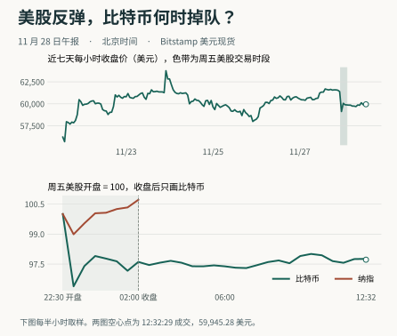

# 比特币与美股午报｜纳指反弹，比特币为何没能守住 6 万美元？

周五美股开盘到提前收盘，纳指涨了 0.71%，比特币却跌了 2.39%；到周六午间，币价只比收盘时高约 69 美元。昨天约定的两次检查，昨晚 23:30 前报 59,750.22 美元，今天 02:00 前报 59,876.73 美元，都低于 60,166 美元，偏弱情景兑现。[昨日判断](/note?p=btc-analysis-2026-11-27) · [首小时](https://www.bitstamp.net/api/v2/ohlc/btcusd/?step=60&limit=4&end=1795793400) · [提前收盘](https://www.bitstamp.net/api/v2/ohlc/btcusd/?step=60&limit=4&end=1795802400)

**短线从中性下调至偏弱，把握中等，判断到周日早上。** 价格走弱的证据最清楚：美股交易时段跌去约 1,468 美元，收盘后收回不到一成。美国比特币基金已披露部分仍有资金撤出，最大一只尚缺数据。北京时间今晚 22:30 和明早 08:00，若两次都站回 60,166 美元，就把判断调回中性。[比特币分时](https://www.bitstamp.net/api/v2/ohlc/btcusd/?step=1800&limit=32&end=1795840350) · [基金分项](https://farside.co.uk/btc/)

## 同一段时间，两边各走了多远？

美东 11 月 27 日是感恩节后的缩短交易日。下表是周五完整交易时段的正式收盘，涨跌相对周三收盘；周四休市。[三大指数](https://apnews.com/article/04dab6079cf7f3dfe7285a3cc1f240a2) · [纽交所日历](https://www.nyse.com/trade/hours-calendars)

| 美股指数 | 周五收盘（点） | 较周三收盘 |
|---|---:|---:|
| 标普 500 | 7,297.49 | +1.60% |
| 纳斯达克综合指数 | 24,129.50 | +2.31% |
| 道琼斯工业平均指数 | 50,774.94 | +1.18% |

纳指的涨幅有一部分发生在开盘前。单看美东 09:30 至 13:00，即北京时间 27 日 22:30 至 28 日 02:00，纳指从 23,958.46 点涨至 24,129.50 点。同期 Bitstamp 比特币从 61,344.62 跌至 59,876.73 美元，落后约 **3.11 个百分点**。周五重开时还保有的感恩节涨幅，到收盘时已全部回吐。此后到午间，比特币仅回升 **0.11%**，美股已经休市。[纳指开收盘](https://query1.finance.yahoo.com/v8/finance/chart/%5EIXIC?interval=1d&range=5d) · [开盘首笔](https://www.bitstamp.net/api/v2/ohlc/btcusd/?step=60&limit=4&end=1795789800) · [收盘前末笔](https://www.bitstamp.net/api/v2/ohlc/btcusd/?step=60&limit=4&end=1795802400) · [节前参照](https://www.bitstamp.net/api/v2/ohlc/btcusd/?step=60&limit=4&end=1795640400)

昨天下午 16:00 至 17:00，币价一度摸到 62,125 美元，高于昨天的上沿，但两个约定时点都已跌破下沿。看下图的 02:00 虚线：科技股的反弹持续到收盘，比特币的主要跌幅却在此前就已发生。上图为已收小时线，下图按半小时对齐、各自开盘设为 100，纳指终点采用正式收盘；空心点是当日尚未收盘的实测成交。[七日小时线](https://www.bitstamp.net/api/v2/ohlc/btcusd/?step=3600&limit=170&end=1795840350) · [BTC 分时](https://www.bitstamp.net/api/v2/ohlc/btcusd/?step=1800&limit=32&end=1795840350) · [纳指分时](https://query1.finance.yahoo.com/v8/finance/chart/%5EIXIC?period1=1795789800&period2=1795802400&interval=30m&includePrePost=false)

## 比特币快照

| Bitstamp BTC/USD | 本期数据 |
|---|---:|
| 最近成交 | 59,945.28 美元 |
| 滚动 24 小时 / 近 7 日 | −2.45% / 约 +7.33% |
| UTC 今日开盘以来 | +0.13%，日线未收盘 |
| 滚动 24 小时最低 / 最高 | 58,718.53 / 62,125.00 美元 |
| 滚动 24 小时成交量 | 1,325.88 枚 BTC |

北京时间 **11 月 28 日 12:34 资料截止**。主报价成交于 12:32:29，编号 683891971；交易所快照和抓取均在 12:32:34。24 小时前基准为 61,448.00 美元。UTC 日线于北京时间 08:00 开盘，开盘价 59,865.00 美元。7 日用上周六同一分钟开盘 55,851.83 美元近似计算。Coinbase 于 12:32:33 报 59,933.86 美元，作独立核对。[行情与成交量](https://www.bitstamp.net/api/v2/ticker/btcusd/) · [本期分钟线](https://www.bitstamp.net/api/v2/ohlc/btcusd/?step=60&limit=3&end=1795840354) · [上周基准](https://www.bitstamp.net/api/v2/ohlc/btcusd/?step=60&limit=3&end=1795235554) · [Coinbase](https://api.exchange.coinbase.com/products/BTC-USD/ticker)

## 为什么科技股的反弹没有传到比特币？

**上涨有明显的股票市场背景。** 受压的芯片股反弹，博通较前收涨 3.82%。与此同时，美国公布 10 月商品贸易逆差从 1,351 亿扩大到 1,495 亿美元，进口增幅大于出口；利率市场仍在为美联储 12 月加息定价。周五美元指数约 104.01，高于周三的 103.67，十年期美债名义收益率从 4.85% 升至 4.94%，扣除通胀影响后的实际收益率从 2.73% 升至 2.79%。这些变化削弱了“资金普遍变宽松、所有风险资产一起涨”的解释。它们能解释比特币面临的压力，却无法辨认每笔卖单的原因。[博通行情](https://query1.finance.yahoo.com/v8/finance/chart/AVGO?interval=1d&range=5d) · [市场与利率预期](https://www.reuters.com/business/wall-st-futures-surge-investors-return-holiday-2026-11-27/) · [美国统计局](https://www.census.gov/econ/indicators/2026/advance_report2610.pdf) · [美元](https://query1.finance.yahoo.com/v8/finance/chart/DX-Y.NYB?interval=1d&range=5d) · [名义利率](https://home.treasury.gov/resource-center/data-chart-center/interest-rates/pages/xml?data=daily_treasury_yield_curve&field_tdr_date_value_month=202611) · [实际利率](https://home.treasury.gov/resource-center/data-chart-center/interest-rates/pages/xml?data=daily_treasury_real_yield_curve&field_tdr_date_value_month=202611)

**基金需求尚未证实回暖。** 美国现货比特币 ETF 周五已披露净流出 **6,180 万美元**，贝莱德 IBIT 仍缺。20、23、24、25、27 日五个交易日暂计净流出 **19.851 亿美元**；周三的 4.53 亿美元净流出没有再修订。周六没有新的美国交易日，暂时无法判断周五最终赎回是否放缓。[逐基金原表](https://farside.co.uk/btc/) · [历史分项](https://farside.co.uk/bitcoin-etf-flow-all-data/)

币安 BTC/USDT 现货提供了方向性证据：周五开盘后的三个半小时，主动买入占成交额的 **48.3%**，周三同样时段为 **50.4%**；总成交额从 3.93 亿增至 4.51 亿 USDT。卖方更急于成交，且成交额增加。这只覆盖币安一个市场。链上则有反证：Coin Metrics 标记的交易所地址周五 UTC 全天初报净转出约 1,224 枚 BTC，周四净转出约 2,869 枚。地址调拨也会影响数字，当天持币人实际兑现的盈亏尚未核实。[周五成交](https://data-api.binance.vision/api/v3/klines?symbol=BTCUSDT&interval=30m&startTime=1795789800000&endTime=1795802399999&limit=7) · [周三同期](https://data-api.binance.vision/api/v3/klines?symbol=BTCUSDT&interval=30m&startTime=1795617000000&endTime=1795629599999&limit=7) · [链上流量](https://community-api.coinmetrics.io/v4/timeseries/asset-metrics?assets=btc&metrics=FlowInExNtv,FlowOutExNtv,CapMVRVCur&frequency=1d&start_time=2026-11-26&end_time=2026-11-27)

展开看杠杆、强制平仓和下跌保护

北京时间 12:28，CoinGlass 覆盖市场过去 24 小时强制平仓约 1.53 亿美元，其中押注上涨的一方约 1.16 亿。未平仓合约名义价值降 2.10% 至 404.78 亿美元。美元计价的持仓会随币价缩水，尚无同口径币数足以确认主动撤仓规模。两组数据支持杠杆损失放大跌势，无法单独锁定最初卖方。[跨交易所数据](https://www.coinglass.com/currencies/BTC)

12:32，Deribit 永续合约的 8 小时资金费率为零，12 月 25 日期货比现货指数贵 0.27%，上期为 0.30%。12:32 至 12:33，同为 12 月 4 日到期的 58,000 看跌与 62,000 看涨期权，对现货的敏感度绝对值均约 0.30；其隐含年化波动率分别为 53.20% 和 47.76%。买下跌保护仍较贵，此处比较两张具体合约。[永续](https://www.deribit.com/api/v2/public/ticker?instrument_name=BTC-PERPETUAL) · [期货](https://www.deribit.com/api/v2/public/ticker?instrument_name=BTC-25DEC26) · [看跌](https://www.deribit.com/api/v2/public/ticker?instrument_name=BTC-4DEC26-58000-P) · [看涨](https://www.deribit.com/api/v2/public/ticker?instrument_name=BTC-4DEC26-62000-C)

## 周末下一次看什么？

以北京时间 **28 日 22:30 前**最后一笔 Bitstamp BTC/USD 成交初判，**29 日 08:00 前**最后一笔确认。下沿取周五美股收盘时的币价 59,876.73 美元，上沿沿用已跌破的节前参照 60,166 美元。[周五锚点](https://www.bitstamp.net/api/v2/ohlc/btcusd/?step=60&limit=4&end=1795802400) · [节前锚点](https://www.bitstamp.net/api/v2/ohlc/btcusd/?step=60&limit=4&end=1795640400)

| 今晚 22:30 的价格 | 明早 08:00 确认 | 对判断的影响 |
|---|---|---|
| 两线之间，含两端 | 仍在两线之间 | 维持偏弱，收盘附近企稳，尚未收复假期涨幅 |
| 高于 60,166 | 仍高于上沿 | 调回中性，关注周一重开后能否守住 |
| 低于 59,876.73 | 仍低于下沿 | 进一步转弱，周末卖压延续 |

第二笔离开首笔所在区间，该情景即失效。现货持有人要区分盘中刺穿与到点守价；合约面对的风险是反弹前先遭强平；链上抵押还取决于协议何时更新价格，需核对其清算用价。

**下一交易日**为 11 月 30 日：北京时间 22:30 美股重开，复核周末涨跌是否延续；23:30 达拉斯联储开始发布得州制造业调查。12 月 1 日 23:00 的美国职位空缺、4 日 21:30 的非农就业，将进一步检验高利率预期。周末首先能验证的是价格，基金新增需求要等美国市场披露。[交易时段](https://www.nyse.com/trade/hours-calendars) · [达拉斯联储](https://www.dallasfed.org/research/surveys/tmos) · [劳工统计局](https://www.bls.gov/schedule/2026/12_sched_list.htm)
